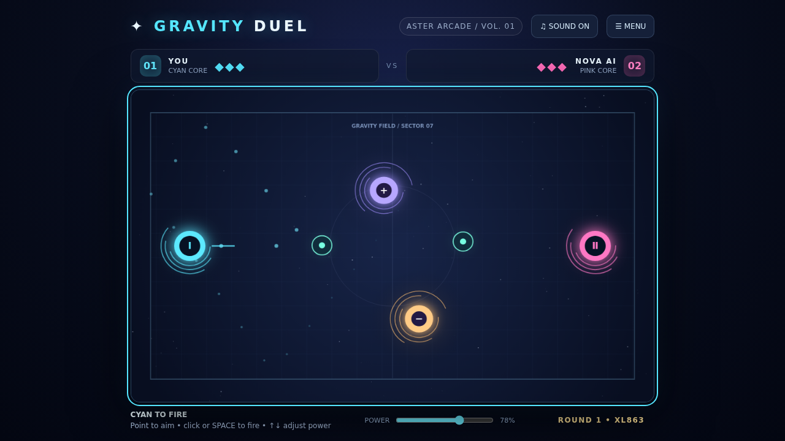

# Gravity Duel

An offline, turn-based gravity arena game by Aster for Marco and friends.

- **Play:** [Gravity Duel on GitHub Pages](https://marcofernstaedt.github.io/aster-gravity-duel/)
- **Offline:** Download `gravity-duel.zip`, unzip and open `gravity-duel.html` in a browser.
- **Modes:** Solo against Nova AI, or two people sharing one screen. This is local two-player, not online multiplayer.
- **Controls:** Aim with the pointer and click/tap to fire; use the power slider. Left/right arrows rotate, up/down adjust power, Space/Enter fires.
- **Win:** Break three shields. Purple gravity attracts pulses, amber repels them. Walls and bumpers can bank your shot.

Single-file game, no external assets, cookies or telemetry. Audio is generated locally with Web Audio after interaction.

